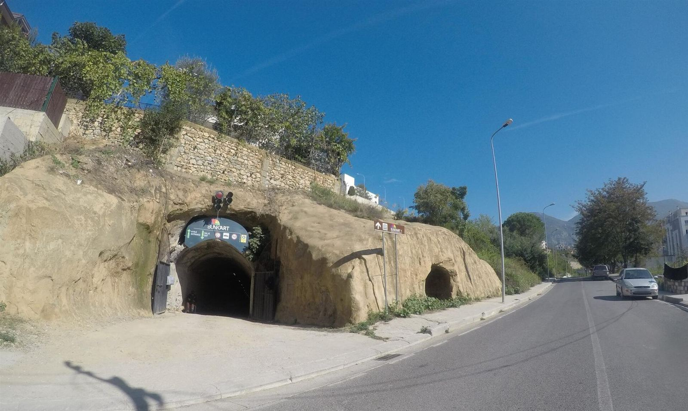
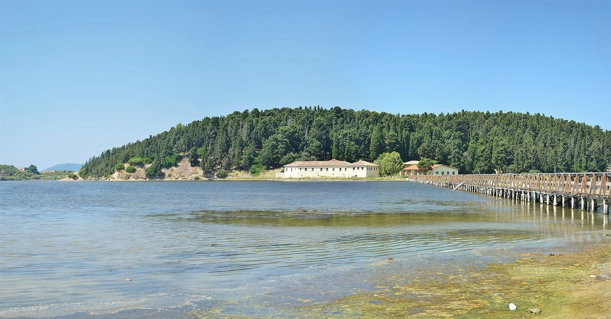
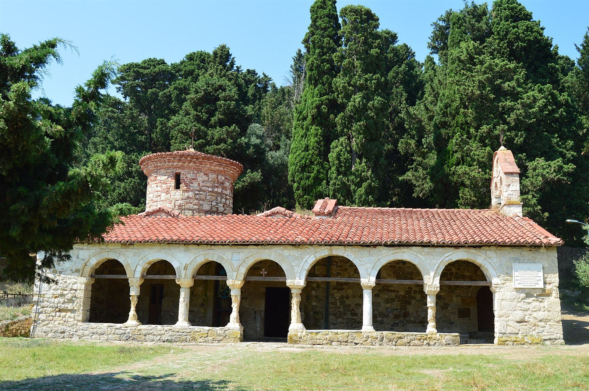

Albania no suele estar en la lista de nadie, y justo por eso sorprende tanto. Es un país pequeño, con mar, montañas y una historia reciente que todavía se nota en todas partes. De todo el viaje, me quedo con dos sitios que no se parecen en nada.

## Bunk'Art: bajar a la Guerra Fría

Durante la dictadura comunista, Albania se llenó de búnkeres: el régimen estaba convencido de que el país iba a ser invadido en cualquier momento. Todavía se ven por todas partes, pequeños y de hormigón, en el campo y en la costa.

<figure class="foto"><figcaption>La entrada a Bunk'Art: un túnel excavado en la colina, a las afueras de Tirana.<small>Foto: <a href="https://commons.wikimedia.org/wiki/File:Bunk%27art_Tunnel_-_Mapillary_(cb9o_yznl64Kd3tv7JVUNA).jpg">kobykarin @ Mapillary</a> · <a href="https://creativecommons.org/licenses/by-sa/4.0/">CC BY-SA 4.0</a> · Wikimedia Commons, redimensionada</small></figcaption></figure>

Bunk'Art es el más impresionante de todos. Es un búnker enorme, construido para que el gobierno y el ejército pudieran resistir un ataque nuclear, y hoy es un museo. Se entra por un túnel largo y frío y, una vez dentro, es un laberinto de pasillos y salas donde cuentan cómo era la vida en el país durante esos años.

**Consejo:** dedícale tiempo. Hay muchas salas y merece la pena leer las historias que cuentan, no solo hacer la foto.

## Zvërnec: un monasterio en una isla

El otro extremo del viaje. Cerca de Vlorë, en la laguna de Narta, hay una islita cubierta de pinos con un pequeño monasterio medieval dentro. Para llegar se cruza un puente de madera larguísimo sobre el agua.

<figure class="foto"><figcaption>La isla de Zvërnec desde la orilla, con el puente de madera a la derecha.<small>Foto: <a href="https://commons.wikimedia.org/wiki/File:Zvernec_monastery,_Albania_(by_Pudelek).jpg">Pudelek (Marcin Szala)</a> · <a href="https://creativecommons.org/licenses/by-sa/3.0/">CC BY-SA 3.0</a> · Wikimedia Commons, redimensionada</small></figcaption></figure>

Es de esos sitios que parecen sacados de un cuento: el agua a los dos lados, el silencio, la pequeña iglesia de piedra entre los árboles. Después de las salas del búnker, este paseo fue justo lo contrario: luz, aire y calma.

<figure class="foto"><figcaption>La iglesia del monasterio, de piedra y con tejado rojo, entre los árboles.<small>Foto: <a href="https://commons.wikimedia.org/wiki/File:Monastery_of_Zvernec.JPG">Flladina Zilja</a> · <a href="https://creativecommons.org/licenses/by-sa/4.0/">CC BY-SA 4.0</a> · Wikimedia Commons, redimensionada</small></figcaption></figure>

**Consejo:** ve con calma y sin prisas, que lo bonito es el paseo por el puente. Y fíjate en la laguna, porque es una zona de aves.

## ¿Merece la pena Albania?

Sí, y mucho. Es un país que sorprende, con sitios muy distintos entre sí a poca distancia. Si te gustan los viajes con historia y lugares que todavía no están llenos de gente, apúntalo.

¿Has estado en Albania o tienes pensado ir? [Escríbeme](/#contacto) y te cuento más.

Foto de portada: <a href="https://commons.wikimedia.org/wiki/File:Zv%C3%ABrrnec_Manastrir_(76361).jpg">Orest222</a> · <a href="https://creativecommons.org/licenses/by-sa/4.0/">CC BY-SA 4.0</a> · Wikimedia Commons, redimensionada.

