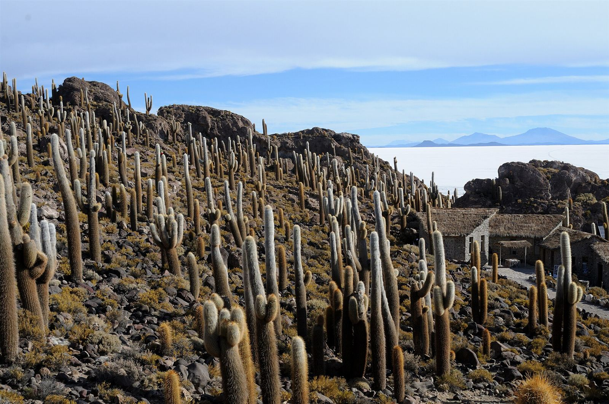
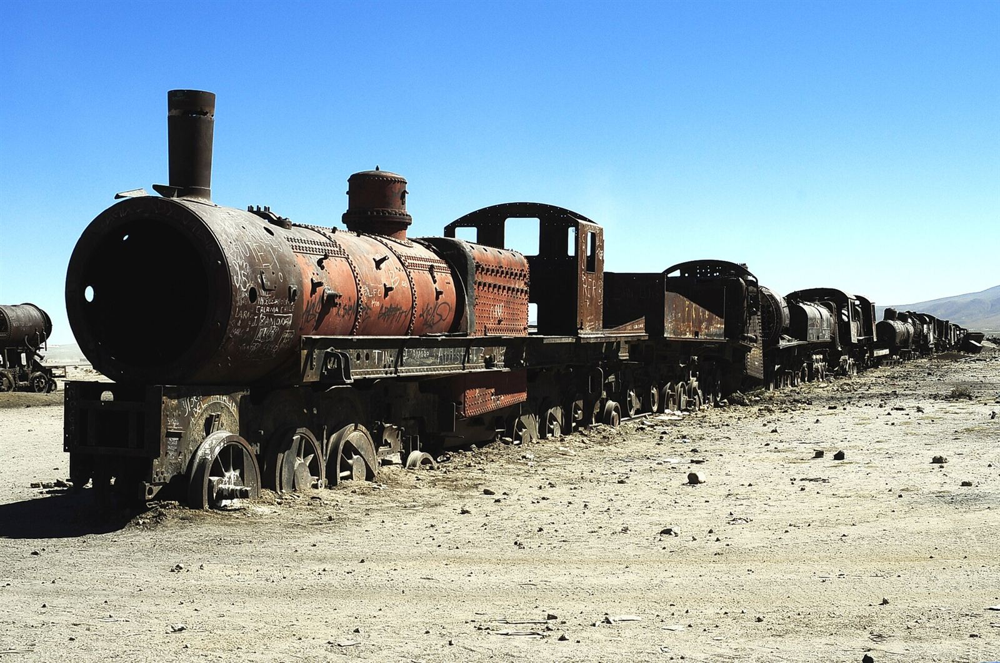

En el suroeste de Bolivia, a unos 3.650 metros de altura, hay una llanura blanca de más de 10.500 kilómetros cuadrados. Es el Salar de Uyuni, el desierto de sal más grande del mundo. Es famoso por las fotos en las que no se sabe dónde acaba el suelo y dónde empieza el cielo.

## Un espejo de verdad

Cuando llueve, sobre todo entre enero y marzo, una capa fina de agua cubre la sal y el salar refleja el cielo casi a la perfección. Las nubes, las montañas y la gente aparecen duplicadas en el suelo. Por eso salen esas fotos tan raras en las que parece que alguien camina por el cielo.

Lo curioso es que no solo sirve para hacer fotos bonitas. El salar es tan plano que la diferencia de altura en toda su superficie es de menos de un metro. Por eso agencias como la NASA y la Agencia Espacial Europea lo usan para calibrar los instrumentos de sus satélites: es una superficie enorme, blanca y casi perfectamente lisa, ideal para comprobar que miden bien.

## Un lago que ya no existe

Hace decenas de miles de años, en esta zona había varios lagos prehistóricos enormes. Al secarse, dejaron la sal acumulada en el fondo, y así se formó el salar. Debajo de esa costra de sal hay agua muy salada rica en litio: Bolivia tiene una de las mayores reservas de litio del mundo y la mayor parte está aquí. Es el mismo material que llevan las baterías de los móviles.

En la orilla hay incluso hoteles construidos con bloques de sal cortados del propio salar: las paredes, el techo y hasta los muebles.

<figure class="foto"><figcaption>Los cactus gigantes de la isla Incahuasi, en mitad del salar.<small>Foto: <a href="https://commons.wikimedia.org/wiki/File:SAL_-_Giant_cactus_forest_on_Incahuasi_Island,_Salar_de_Uyuni,_Bolivia,_2013.jpg">Josep M. Gracia</a> · <a href="https://creativecommons.org/licenses/by-sa/4.0/">CC BY-SA 4.0</a> · Wikimedia Commons, redimensionada</small></figcaption></figure>

En medio de tanta sal hay islas de roca, como Incahuasi, cubiertas de cactus gigantes. Crecen alrededor de un centímetro al año y pueden llegar a superar los diez metros, así que los más altos tienen muchísimos años.

## El cementerio de trenes

A unos 3 kilómetros del pueblo de Uyuni hay otro sitio muy curioso: locomotoras y vagones oxidados abandonados en mitad del desierto.

<figure class="foto"><figcaption>Locomotoras oxidadas en el cementerio de trenes de Uyuni.<small>Foto: <a href="https://commons.wikimedia.org/wiki/File:Cementerio_de_trenes_de_Uyuni_01.jpg">LBM1948</a> · <a href="https://creativecommons.org/licenses/by-sa/4.0/">CC BY-SA 4.0</a> · Wikimedia Commons, redimensionada</small></figcaption></figure>

A finales del siglo XIX, ingenieros británicos construyeron un ferrocarril para llevar los minerales de la zona hasta los puertos del Pacífico. Cuando la minería se hundió en los años cuarenta, muchos trenes se quedaron aquí, y el clima seco ha hecho el resto.

**Dato curioso:** como el salar es tan blanco y tan plano, se pierde por completo la sensación de distancia. Por eso mucha gente aprovecha para hacer fotos de perspectiva, jugando con objetos pequeños que parecen gigantes.

Foto de portada: <a href="https://commons.wikimedia.org/wiki/File:Salar_de_Uyuni,_Bolivia,_2016-02-04,_DD_10-12_HDR.JPG">Diego Delso</a> · <a href="https://creativecommons.org/licenses/by-sa/4.0/">CC BY-SA 4.0</a> · Wikimedia Commons, redimensionada.

