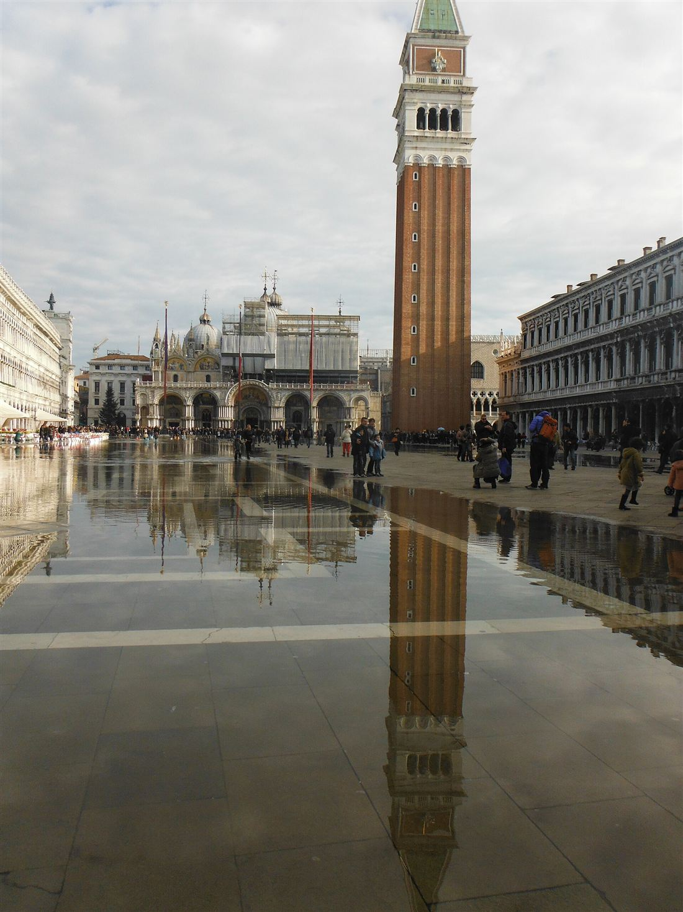
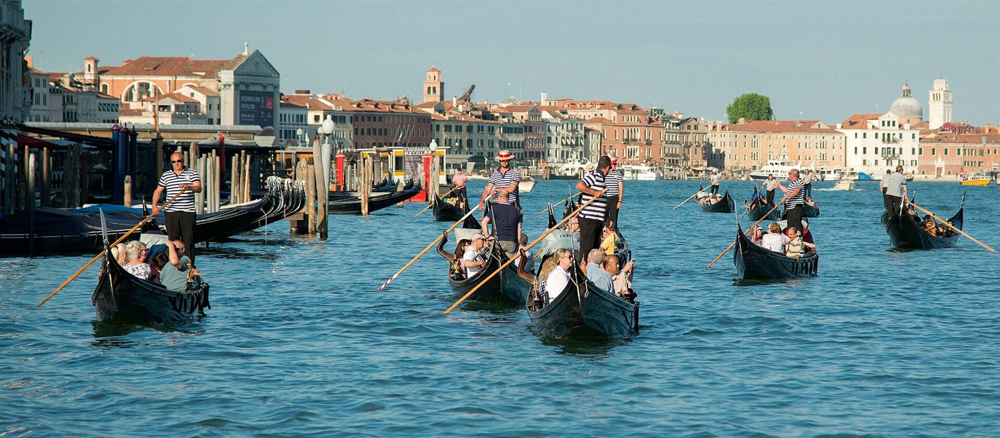

Venecia está repartida entre más de un centenar de islas pequeñas en mitad de una laguna, unidas por más de 400 puentes. Ya eso es raro, pero lo más curioso está debajo: la ciudad entera se apoya sobre troncos de madera.

## Un bosque al revés

Los primeros venecianos no podían construir directamente sobre el barro de la laguna, así que clavaron troncos muy juntos, uno al lado del otro, hasta llegar a una capa de arcilla mucho más dura. Encima colocaron plataformas de piedra y, sobre ellas, levantaron las casas, las iglesias y los palacios.

Lo sorprendente es que muchos de esos troncos siguen ahí siglos después. La explicación es bastante científica: al estar enterrados en barro y agua, casi sin oxígeno, los hongos y bacterias que pudren la madera apenas pueden trabajar.

Eso sí, la ciudad se hunde poco a poco, entre uno y dos milímetros al año, y el nivel del mar sube. Mala combinación.

## Cuando el mar entra en la plaza

En Venecia tienen hasta nombre para las inundaciones: *acqua alta*, «agua alta». Pasa sobre todo en otoño e invierno, cuando la marea sube más de la cuenta y el agua cubre las zonas más bajas, como la plaza de San Marcos.

<figure class="foto vertical"><figcaption>La plaza de San Marcos durante un episodio de acqua alta.<small>Foto: <a href="https://commons.wikimedia.org/wiki/File:Acqua_alta_DSCF4850.jpg">Antonio Fiol</a> · <a href="https://creativecommons.org/licenses/by/2.0/">CC BY 2.0</a> · Wikimedia Commons, redimensionada</small></figcaption></figure>

El 13 de noviembre de 2019 el agua llegó a 1,87 metros, la marea más alta desde 1966, y cubrió más del 80 % de la ciudad.

Para defenderse, Venecia tiene ahora el MOSE: 78 compuertas gigantes instaladas en las tres entradas de la laguna. Normalmente están en el fondo del mar, llenas de agua y sin que nadie las vea. Cuando se espera una marea alta, se les inyecta aire, suben y hacen de muro. Se usó por primera vez el 3 de octubre de 2020, y ese día la plaza de San Marcos se quedó seca.

## Las góndolas, negras por ley

<figure class="foto"><figcaption>Góndolas en el Gran Canal.<small>Foto: <a href="https://commons.wikimedia.org/wiki/File:Gondolas,_Grand_Canal,_Venice.jpg">Peter K Burian</a> · <a href="https://creativecommons.org/licenses/by-sa/4.0/">CC BY-SA 4.0</a> · Wikimedia Commons, redimensionada</small></figcaption></figure>

Entre los siglos XVII y XVIII llegó a haber entre 8.000 y 10.000 góndolas. Hoy quedan unas 400 en servicio, y más o menos el mismo número de gondoleros con licencia. Son todas negras porque una antigua ley veneciana contra el lujo obligaba a pintarlas de ese color.

Otra cosa en la que casi nadie se fija: no son simétricas. Un lado del casco es más curvo que el otro, y eso es lo que permite que el gondolero la mueva con un solo remo sin ir dando vueltas. Miden hasta 11 metros y pesan unos 350 kilos.

**Dato curioso:** hasta 2010 no hubo ninguna mujer gondolera con licencia completa. La primera fue Giorgia Boscolo, en agosto de ese año.

Foto de portada: <a href="https://commons.wikimedia.org/wiki/File:Venice_awakes_(20618763815).jpg">Benh LIEU SONG (Flickr)</a> · <a href="https://creativecommons.org/licenses/by-sa/4.0/">CC BY-SA 4.0</a> · Wikimedia Commons, redimensionada.

