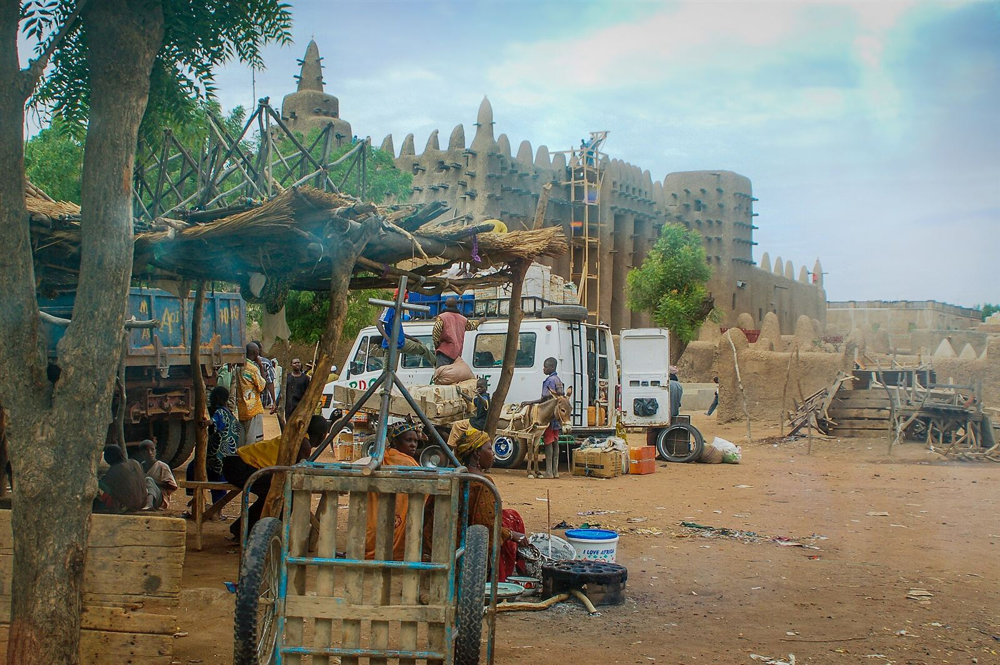
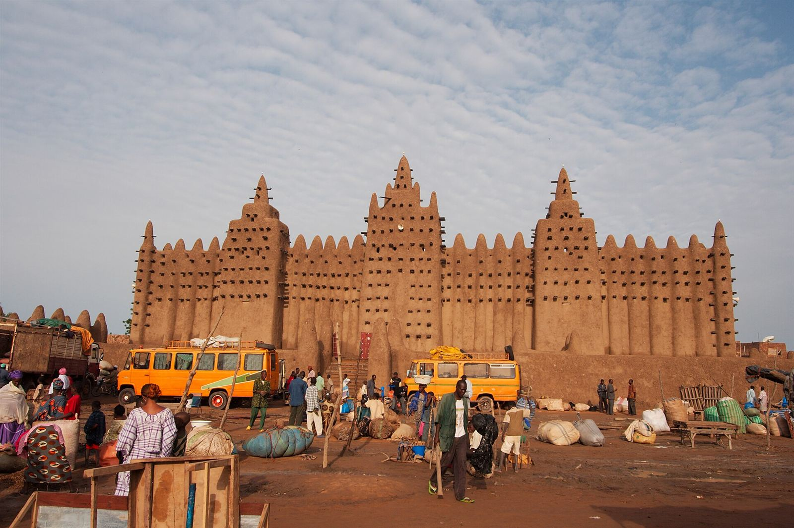

En Djenné, una ciudad de Mali, hay un edificio que parece un castillo de arena gigante. Es la Gran Mezquita, y está hecha casi entera de barro. Se considera el edificio de adobe más grande del mundo. Lo más curioso es que no aguanta sola: cada año los vecinos tienen que volver a cubrirla de barro, y lo hacen todos juntos.

## Un edificio de ladrillos secados al sol

Los muros son de ladrillos de tierra secados al sol, unidos con un mortero de arena y tierra y cubiertos con un enlucido de barro. Todo el conjunto se levanta sobre una plataforma de unos 75 por 75 metros, a 3 metros por encima de la plaza del mercado. La torre central llega a los 16 metros.

Lo que más llama la atención son los palos que asoman por todas partes. Son troncos de palmera, que allí llaman *toron*, y salen unos 60 centímetros de la pared. No son solo decoración: sirven de andamio fijo para subir a arreglar los muros.

La mezquita que se ve hoy es de 1906-1907. La levantó el gremio de albañiles de la ciudad, dirigido por Ismaila Traoré. Pero en ese mismo sitio hubo antes otra mucho más antigua, quizá del siglo XIII. A principios del siglo XIX, un líder llamado Seku Amadu la dejó caer en ruinas porque no le gustaba, y entre 1834 y 1836 construyó otra más baja y sin torres, al lado.

## La fiesta del barro

Aquí entra la ciencia. El barro aguanta bien el calor, pero la lluvia lo va deshaciendo, y los cambios de temperatura y de humedad le abren grietas. Si nadie hiciera nada, en pocos años los muros empezarían a desmoronarse.

Por eso, hacia el final de la estación seca y antes de que lleguen las lluvias, se celebra el *crépissage* (el «enlucido»). Durante días se prepara el barro en fosos y se deja reposar, y suelen ser los chicos jóvenes quienes lo remueven. El día grande, los hombres suben por los palos y las escaleras de palmera y van extendiendo el barro con las manos. Otro grupo les lleva las cargas, y hasta hay una carrera para ver quién entrega la primera. Las mujeres y las chicas acarrean el agua, los maestros albañiles dirigen el trabajo y los mayores lo miran todo desde la plaza. Hay música y comida, así que es trabajo y fiesta a la vez.

<figure class="foto"><figcaption>Escaleras apoyadas en el muro de la mezquita, junto al mercado.<small>Foto: <a href="https://commons.wikimedia.org/wiki/File:Market_near_the_Great_Mosque_of_Djenn%C3%A9_in_Mali._(38865479781).jpg">Ralf Steinberger</a> · <a href="https://creativecommons.org/licenses/by/2.0">CC BY 2.0</a> · Wikimedia Commons, redimensionada</small></figcaption></figure>

## Una ciudad muy antigua que se convierte en isla

Djenné está en una llanura entre los ríos Níger y Bani. Cada año, con la crecida, que llega a su punto más alto en octubre, la ciudad se queda rodeada de agua como si fuera una isla.

Muy cerca está Djenné-Djeno, un yacimiento que empezó a habitarse hacia el año 200 antes de Cristo. Entre los siglos XV y XVII, Djenné fue una pieza clave del comercio de sal y oro que cruzaba el Sáhara pasando por Tombuctú.

<figure class="foto"><figcaption>Ambiente de mercado delante de la Gran Mezquita.<small>Foto: <a href="https://commons.wikimedia.org/wiki/File:Moschee_von_Djenn%C3%A9.jpg">qiv</a> · <a href="https://creativecommons.org/licenses/by-sa/2.0">CC BY-SA 2.0</a> · Wikimedia Commons, redimensionada</small></figcaption></figure>

En 1988 la UNESCO declaró Patrimonio de la Humanidad las ciudades antiguas de Djenné, y desde 2016 están en su lista de patrimonio en peligro por la inseguridad en la zona. Es uno de esos sitios que tengo apuntados para algún día.

**Dato curioso:** los no musulmanes no pueden entrar en la mezquita. La prohibición viene de finales de los años noventa, después de una sesión de fotos de moda dentro del edificio que sentó muy mal en la ciudad.

Foto de portada: <a href="https://commons.wikimedia.org/wiki/File:Djenne_great_mud_mosque.jpg">Ruud Zwart</a> · <a href="http://creativecommons.org/licenses/by-sa/3.0/">CC BY-SA 3.0</a> · Wikimedia Commons, redimensionada.

